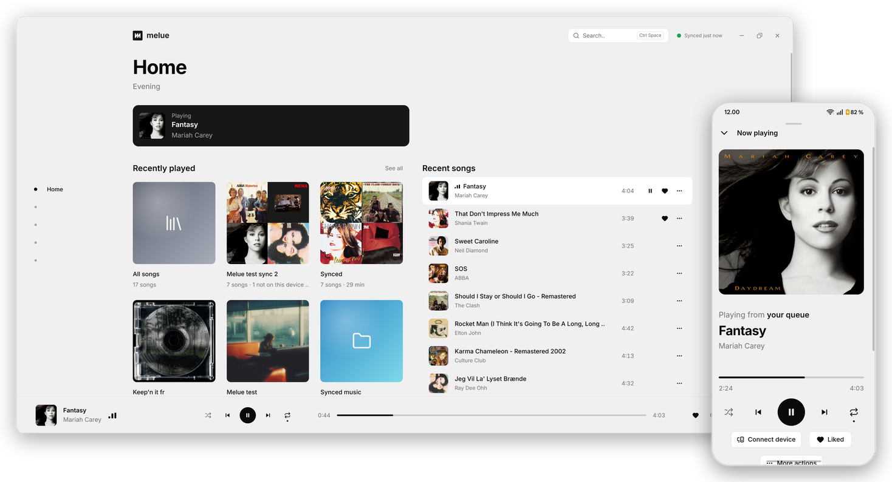
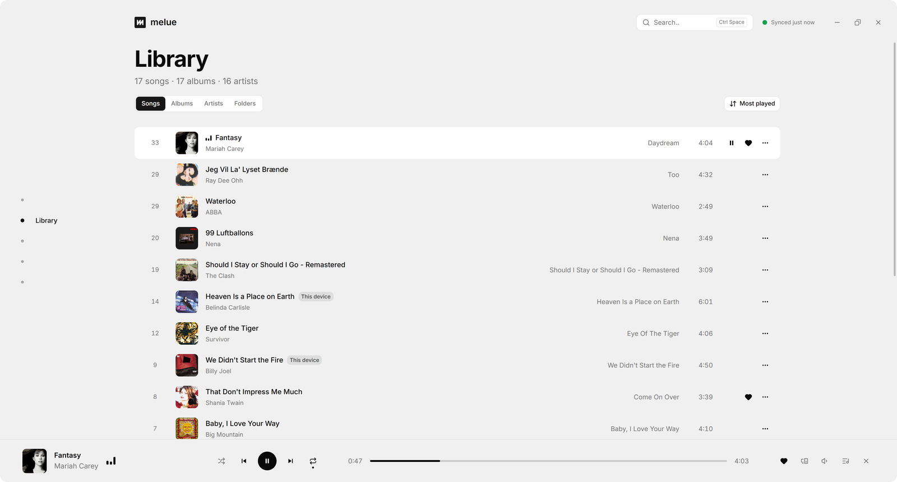
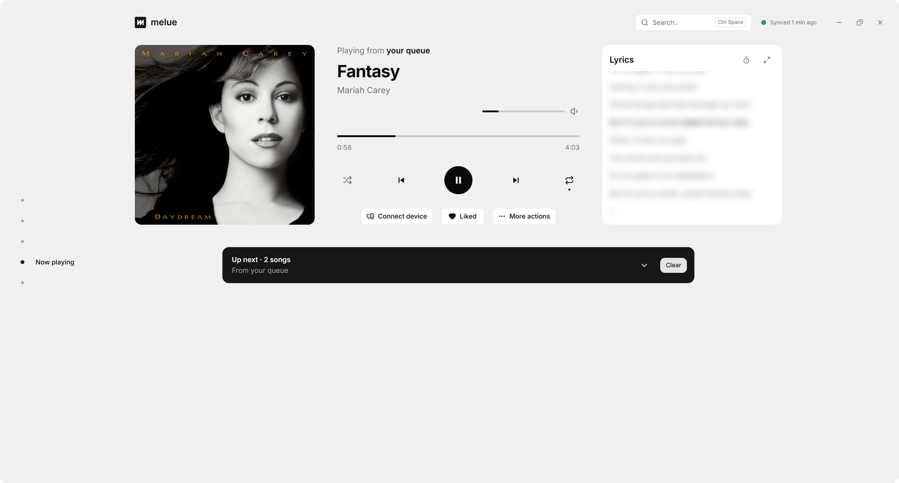
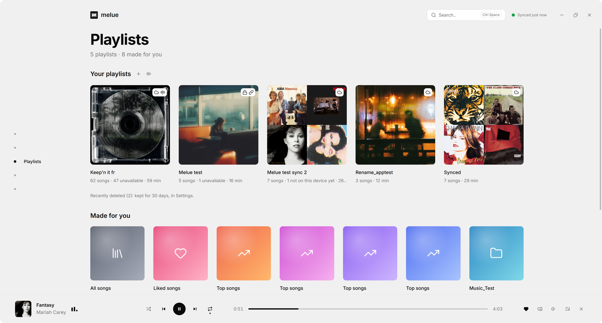
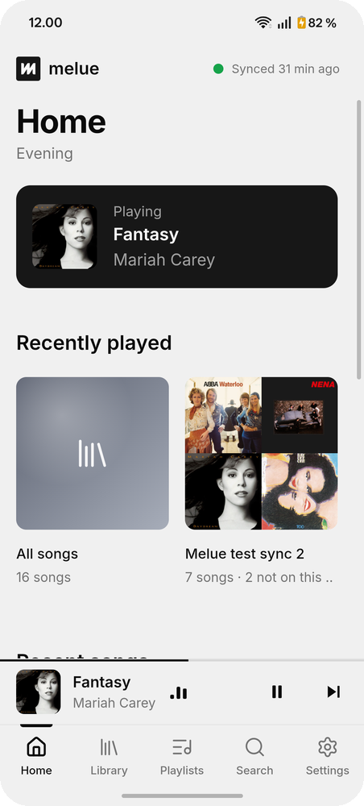
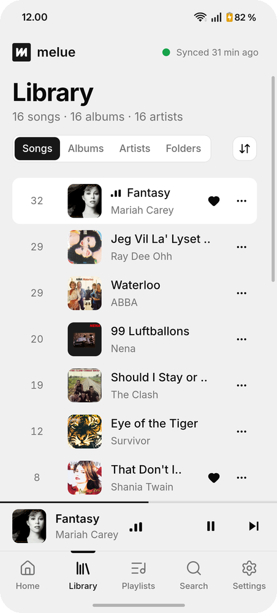
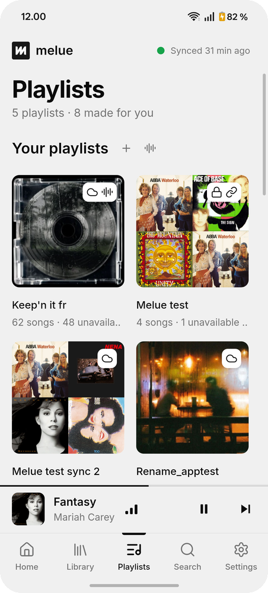
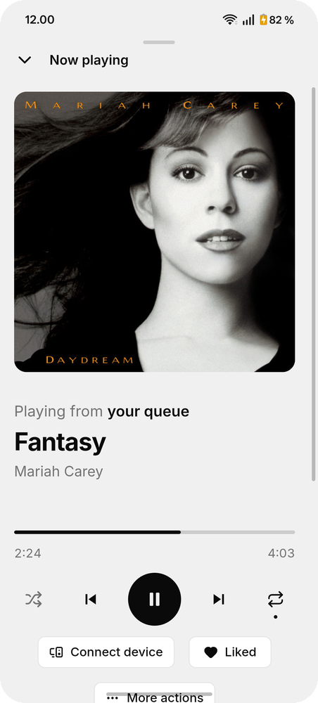

<p align="center">
  
</p>

<h1 align="center">Melue</h1>

<p align="center">
  Your own music, on your computer and your phone. No streaming, no ads, no account.
</p>

<p align="center">
  <a href="https://github.com/Sjims05/Melue/releases/latest"></a>
  
  
</p>

<picture>
  <source media="(prefers-color-scheme: dark)" srcset="docs/screenshots/hero-dark.png" />
  
</picture>

Melue plays the music files you own: MP3, AAC, FLAC and more, from folders on your computer or phone. Keep your
library on a network share (a NAS, or a shared folder on another computer) and every device gets the same songs,
playlists, likes and settings. Start a song on your phone and continue it on your computer, or play your phone's
music on your computer's speakers.

## What it does

**Your library, on every device.** Songs, albums, artists and folders, with covers. Home brings back what you played
last; "Made for you" playlists follow your likes and your most played songs. Search finds songs, albums, artists,
playlists and settings.

<picture>
  <source media="(prefers-color-scheme: dark)" srcset="docs/screenshots/desktop-songs-dark.png" />
  
</picture>

**Synced through your own share.** Melue copies the music from your share to each device, so it plays offline, and
keeps your playlists, likes, play counts and settings the same everywhere. A phone can wait for Wi-Fi for the songs.
On a computer, Melue also watches your music folders and picks up songs as you add them.

**Your devices work together.** When another device was playing, Melue offers to continue right where it stopped.
Connect device plays on another of your devices, like your phone's queue on your computer's speakers, with the
phone as the remote.

**Now playing, with lyrics.** Timed lyrics follow the song, word by word where the lyrics have it. They come from a
`.lrc` file next to the song or its tags, or online from [LRCLIB](https://lrclib.net) if you allow it. Timing that's
off can be fixed by tapping the lines as they're sung.

<picture>
  <source media="(prefers-color-scheme: dark)" srcset="docs/screenshots/desktop-nowplaying-dark.png" />
  
</picture>

**Playlists, including Spotify's.** Make your own, with your own cover or a collage of their songs. Paste the link
to a public Spotify playlist and Melue matches its songs to the ones you have, and follows it as it changes. No
Spotify sign-in or Premium needed.

<picture>
  <source media="(prefers-color-scheme: dark)" srcset="docs/screenshots/desktop-playlists-dark.png" />
  
</picture>

**Made for your phone too.** A phone layout of its own, Android's media controls and notification, Android Auto, and
a battery-friendly player.

<p align="center">
  <picture>
    <source media="(prefers-color-scheme: dark)" srcset="docs/screenshots/phone-home-dark.png" />
    
  </picture>
  <picture>
    <source media="(prefers-color-scheme: dark)" srcset="docs/screenshots/phone-songs-dark.png" />
    
  </picture>
  <picture>
    <source media="(prefers-color-scheme: dark)" srcset="docs/screenshots/phone-playlists-dark.png" />
    
  </picture>
  <picture>
    <source media="(prefers-color-scheme: dark)" srcset="docs/screenshots/phone-nowplaying-dark.png" />
    
  </picture>
</p>

**And more.** The keyboard everywhere on a computer (arrow keys, M for menus, Ctrl+Space to search), media keys and
the system's media panel, a dark and a light theme (or one by the clock), "Listening to" in your Discord status, a
bug report straight from the app, and updates that install themselves.

### Computer or phone

Almost everything works on both. The differences:

| | Computer | Phone |
| --- | :---: | :---: |
| Keyboard navigation and shortcuts | ✓ | |
| Watches your music folders for new songs | ✓ | |
| Discord status, tray icon, start with Windows | ✓ | |
| Android Auto | | ✓ |
| Songs wait for Wi-Fi (mobile data limits) | | ✓ |
| Everything else | ✓ | ✓ |

## Download

Get the latest version from [Releases](https://github.com/Sjims05/Melue/releases/latest):

- **Windows 10 or 11, 64-bit:** `Melue_…_x64-setup.exe` (or the `.msi`).
- **Android 8 or newer:** `Melue_…_android.apk`. Android asks once to allow installing apps from your browser or
  files app.

Melue plays MP3, FLAC, AAC and ALAC (`.m4a`), Ogg Vorbis and WAV files, with their tags and covers (embedded, or a
`cover.jpg` / `folder.jpg` next to them).

Melue updates itself on both: it says when a new version is out, and installs it when you say so.

## Getting started

1. **Add your music.** Settings, Library: pick your music folders. On a phone, Melue can also use all the music
   Android knows about.
2. **Sync across devices (optional).** Settings, Library: connect to your share (its address, a user name and
   password). Melue keeps a hidden folder there for your playlists, likes and settings; Settings, Syncing says when
   it syncs.
3. **Add your other devices.** Install Melue on them and connect them to the same share. They find each other
   through it, for continuing and Connect device.

## FAQ

**Does Melue stream music?** No. It plays files you have. Spotify playlists are matched to your own songs; Melue
never plays anything from Spotify.

**Can I use Melue without syncing anything?** Yes. Without a share, Melue is a music player for the folders on that
device: nothing leaves it, and nothing else is needed.

**Do I need to keep my NAS or shared folder online?** Only for syncing. Each device keeps its own copy of the songs
and plays them offline; a sync needs the share to be reachable, so a phone syncs when Melue is open on the same
network as the share (at home, say). Away from home it can sync over mobile data if it can reach the share, through
a VPN to your home network for example, and within what Settings, Syncing allows on mobile data. Continuing on
another device and Connect device need both devices online too.

**What happens when I add or remove a song?** Put it in your share's music folder, or in a music folder on a
computer: Melue picks it up (a computer watches its folders; the other devices get it at their next sync). Easier
still, drop the files on Melue on a computer: it copies them into the right place by their tags (`Artist/Album/`),
on your share when you have one, and, on a playlist's page, into that playlist too. A song removed from the share is
kept on your devices or removed there too (a setting); one deleted on a device only comes back at the next sync.

**Does Melue need Spotify Premium or a Spotify account?** No. A playlist only needs to be public: paste its link
and Melue reads it like a web browser would, with no sign-in.

**What happens if a song from a Spotify playlist isn't in my library?** It stays in the playlist, greyed out, so you
can see what's missing; the missing songs' list can be copied. When you add the song later, it fills in by itself.

**Is there a version for macOS, Linux or iPhone?** Not as a download. Melue is built with Tauri, so macOS and
Linux builds from source should work, but they aren't tested yet; there's no iPhone version.

**Where are my playlists and likes kept?** In Melue's library on each device, and in a hidden `.melue` folder on
your share when you sync. Playlists can also be exported as `.m3u8` files.

## Privacy

Melue has no account, no tracking and no ads. Your music and your data stay on your devices and your share; the
password is kept in your system's secure storage. Melue goes online only for:

- lyrics from LRCLIB, if you switch it on (on a phone, on Wi-Fi only);
- Spotify playlists whose link you paste (their public page);
- album covers for your Discord status, from the Cover Art Archive, if you connect Discord;
- checking GitHub for a new version.

## Bugs and ideas

In Melue: Settings, About, Report a bug (or Ctrl+Shift+B on a computer). It shows the report before anything is
sent, with personal details like names, addresses and paths replaced. It goes here as an issue from your GitHub
account (signed in under Settings, Connections), or is copied for you to paste. Or open an
[issue](https://github.com/Sjims05/Melue/issues) yourself.

## Building it yourself

You need [Node.js](https://nodejs.org), [Rust](https://rustup.rs) and
[Tauri's prerequisites](https://tauri.app/start/prerequisites/); for Android also the Android SDK and NDK. Melue's
player is [tauri-plugin-native-audio](https://github.com/Sjims05/tauri-plugin-native-audio), next to it in the same
folder:

```sh
git clone https://github.com/Sjims05/tauri-plugin-native-audio.git
git clone https://github.com/Sjims05/Melue.git
cd Melue
npm install
npm run tauri dev           # a computer
npm run tauri android dev   # a phone, over USB
```

A build from source is "Melue Dev": its own app next to Melue, with its own library and settings, that never updates
itself.

## Credits

Built with [Tauri](https://tauri.app), [Vue](https://vuejs.org), [shadcn-vue](https://www.shadcn-vue.com) and
[Lucide](https://lucide.dev) icons. Playback by [Media3 ExoPlayer](https://developer.android.com/media/media3) on
Android and [Symphonia](https://github.com/pdeljanov/Symphonia) with [cpal](https://github.com/RustAudio/cpal) on
computers. Lyrics from [LRCLIB](https://lrclib.net). The library in [SQLite](https://sqlite.org), through
[rusqlite](https://github.com/rusqlite/rusqlite).

## License

[MIT](LICENSE)
